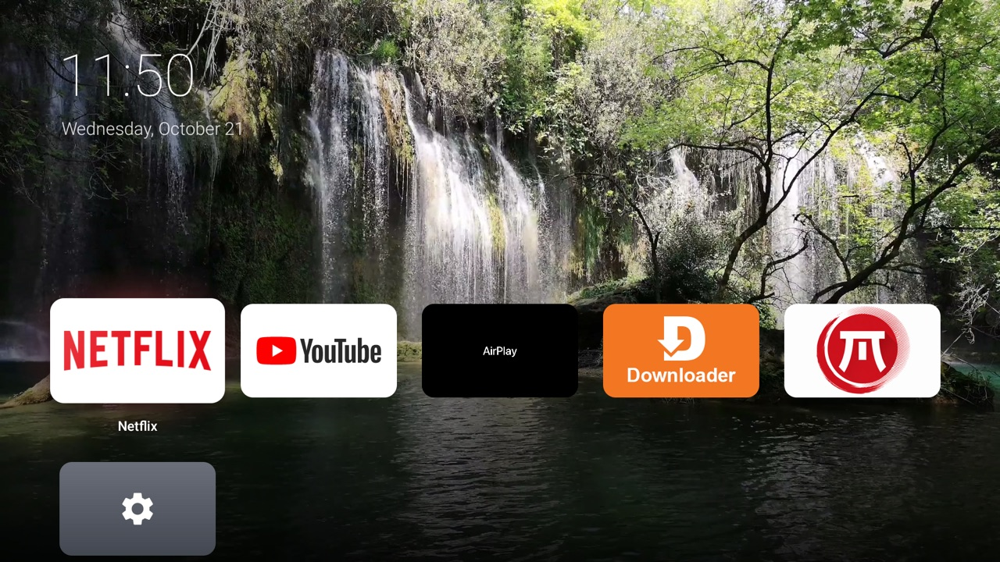
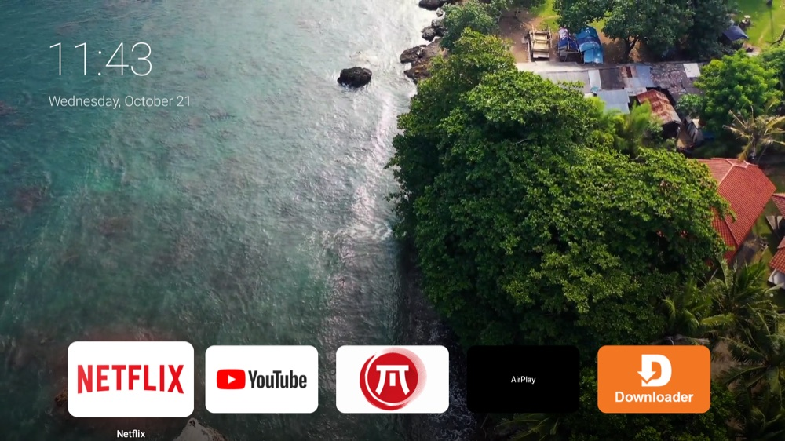
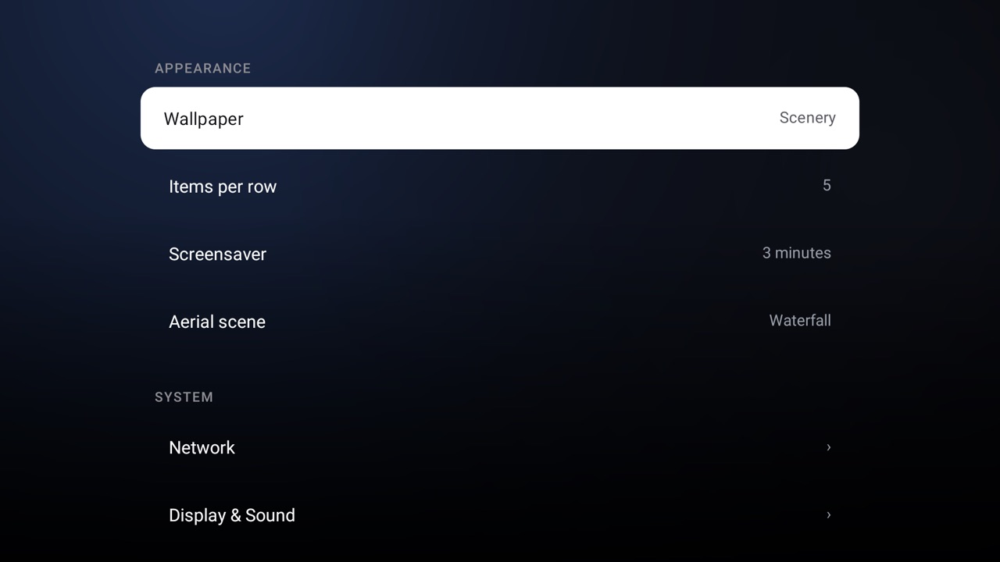

# Aerie

A calm, ad-free home screen for Amazon Fire TV, in the spirit of Apple TV. No root needed.

Aerie replaces the Fire TV home screen with a single row of your apps on a
scenic wallpaper, a clock, and slow-motion aerial screensavers. There are no
banners, carousels, sponsored rows or "recommended for you".



| Screensaver | Settings |
| --- | --- |
|  |  |

## Features

- **tvOS-style grid.** Large rounded tiles, 4–6 per row (they resize to fit).
  The focused app lifts with a soft shadow, a light sheen and a faint glow in
  its own colour, and its name fades in underneath.
- **Aerial screensaver.** One scene of your choice, played full-screen at half
  speed and looping seamlessly. When it starts, your apps slide down and rest
  along the bottom while the scene rises in behind them. Press any button and
  they slide back up; the scene eases to a stop and becomes the wallpaper.
- **Scenery wallpaper.** The home background is a still from your aerial scene,
  shaded so the tiles and clock stay readable. Or pick Dynamic (tints to the
  focused app) or one of five colour themes.
- **Clock.** Time and date in the top-left corner, in the same place on the
  home screen and in the screensaver.
- **Settings that work.** One screen for Aerie's options and every Fire TV
  settings page an app is allowed to open: Network, Remotes & Bluetooth,
  pairing, Applications, Notifications, About, updates, USB drive and
  Developer options each open directly. The pages Amazon reserves for its own
  apps (Accessibility, Display & Audio, Inputs, Preferences, Parental
  controls, Account & Profiles) are one step away through the full Fire TV
  Settings grid.
- **Accessibility.** Reduce motion (fades instead of zooming and sliding),
  always show app names, and larger text, plus a shortcut to Fire TV's own
  accessibility features (VoiceView, captions, magnifier, high contrast text).
- **Hidden apps.** Hide apps from the grid and bring them back from Settings.
- **Your order.** Hold Select (or press the ≡ Menu button) on any tile to move
  it, send it to the top row, or hide it.
- **Small.** About 40 KB, plain Java, no libraries.

## How it takes over the Home button (and its limits)

Fire OS doesn't let you replace its launcher the way Android TV does. On
current firmware Amazon's launcher is a *protected package*: it can't be
uninstalled, disabled or force-stopped without root, and Fire OS handles the
Home key itself before any app sees it.

Aerie works within that:

1. It registers as a home app and is set as the preferred one, so the TV boots
   straight into it.
2. A small accessibility service (*Aerie Home button*) watches for Amazon's
   home screen. The moment it starts to appear, Aerie covers the screen with a
   snapshot of itself and brings itself to the front underneath, so you
   shouldn't see Amazon's screen at all.

What that means in practice: Amazon's launcher still exists and sits idle in
memory, but with the debloat script below its ads and recommendation services
are switched off and it is never shown.

The same wall applies to settings: many Fire TV settings pages require a
permission only Amazon-signed apps can hold (`com.amazon.tv.permission.LAUNCHER_SETTINGS`
and similar), so no third-party app can open them directly. Aerie links to
every page that is open, and to Amazon's full settings grid for the rest.

## Install

You need a computer on the same network as the TV with:

- `adb` (Android platform-tools)
- a JDK 17 or newer
- the Android SDK's `build-tools;34.0.0` and `platforms;android-34`
  (`sdkmanager "build-tools;34.0.0" "platforms;android-34"`)
- for the aerial scenes: `curl`, `ffmpeg`, and Python 3 with `numpy`

On the TV, turn on **Settings → My Fire TV → Developer options → ADB
debugging** (if Developer options is hidden, open **About** and press Select on
the device name seven times). Note the TV's IP address under **About →
Network**.

Then, using your TV's address:

```sh
git clone https://github.com/mrandhawa14/aerie.git
cd aerie

# 1. Build and install. Accept the "Allow USB debugging?" prompt on the TV.
TV=192.168.1.50 ./build.sh install

# 2. Download the aerial scenes, cut them into loops and send them to the TV.
TV=192.168.1.50 tools/fetch-aerials.sh

# 3. (Optional) Remove Fire OS ads, tracking and preinstalled apps.
#    Read the list in the script first; it's reversible with --restore.
TV=192.168.1.50 tools/debloat-firetv.sh

# 4. Make Aerie the home screen. This checks each step, reboots the TV to
#    confirm it starts in Aerie, and rolls back on its own if anything fails.
TV=192.168.1.50 tools/make-default-home.sh
```

To go back to Amazon's home screen: `TV=192.168.1.50 tools/restore-amazon-home.sh`,
then uninstall Aerie if you like.

## Using it

| Remote | Does |
| --- | --- |
| D-pad | Move between apps |
| Select | Open the app |
| Hold Select, or ≡ Menu | Move / hide the app, show hidden apps |
| Home | Back to Aerie (from anywhere) |
| Any button during the screensaver | Wake up |

Settings is the gear tile at the end of your apps.

## Aerial scenes

Scenes are `name.mp4` + `name.jpg` pairs in Aerie's folder on the TV
(`/sdcard/Android/data/io.github.mrandhawa14.aerie/files/aerials`). Choose
one under **Settings → Aerial scene**.

`tools/findloop.py` makes a clip loop without a visible seam: it searches for
the run of frames that looks most like the opening (matching motion as well as
the picture), cuts there, and cross-fades the last moments back into the start.
Shots with a nearly still camera loop almost perfectly; shots where the camera
keeps travelling get a slower dissolve. To add your own scene:

```sh
python3 tools/findloop.py my-clip.mp4 aerials/myscene.mp4 1.5
ffmpeg -i aerials/myscene.mp4 -frames:v 1 -q:v 2 aerials/myscene.jpg
TV=192.168.1.50 tools/fetch-aerials.sh   # pushes everything in ./aerials
```

The default scenes are free clips from Pexels, used under the
[Pexels license](https://www.pexels.com/license/); they're downloaded by the
script, not stored in this repository:
[Waterfall](https://www.pexels.com/video/2098988/),
[Coast](https://www.pexels.com/video/1409899/),
[Tropical coast](https://www.pexels.com/video/2169880/).

## Project layout

```
AndroidManifest.xml
build.sh                      build (and optionally install) without Gradle
src/io/github/mrandhawa14/aerie/
  HomeActivity.java           the home screen: grid, focus, clock, screensaver hand-off
  SettingsActivity.java       Aerie settings + Fire TV settings shortcuts
  Screensaver.java            looping aerial playback, eased stop
  Wallpaper.java              scenery / dynamic / colour backdrops
  ClockView.java              shared clock (same spot on home and screensaver)
  HomeOverrideService.java    keeps Amazon's home screen from showing
  Prefs.java, Scenes.java     settings and scene files
res/                          theme, icons, accessibility service config
tools/                        TV setup scripts and the loop finder
```

## Roadmap

Ideas, roughly in order. Contributions welcome.

- **Top shelf**: show an app's "continue watching" or featured items above the
  first row (from the Android TV channels/preview programs API).
- **Control Center**: long-press Home for sleep, HDMI inputs, audio output and
  picture mode.
- **Inputs as tiles**: HDMI sources and antenna on the home screen for Fire TV
  smart TVs.
- **Move mode**: rearrange apps by "picking up" a tile and sliding it, like
  tvOS, instead of a menu.
- **Folders**.
- **Scenes on the TV**: browse and download new aerial scenes from Settings,
  no computer needed.
- **Focus details**: parallax tilt and a soft click sound on focus.
- **Releases**: signed APKs on GitHub Releases, so building isn't required.

## Contributing

Issues and pull requests are welcome. Please test on a real Fire TV if you
can, and say which device and Fire OS version you used. `./build.sh` should
stay dependency-free (no Gradle, no libraries).

## License

[GPL-3.0](LICENSE). If you distribute a modified Aerie, its source must be
available under the same license.

Aerie is an independent project, not affiliated with or endorsed by Amazon
or Apple. Fire TV is a trademark of Amazon.com, Inc.; Apple TV is a trademark
of Apple Inc.
